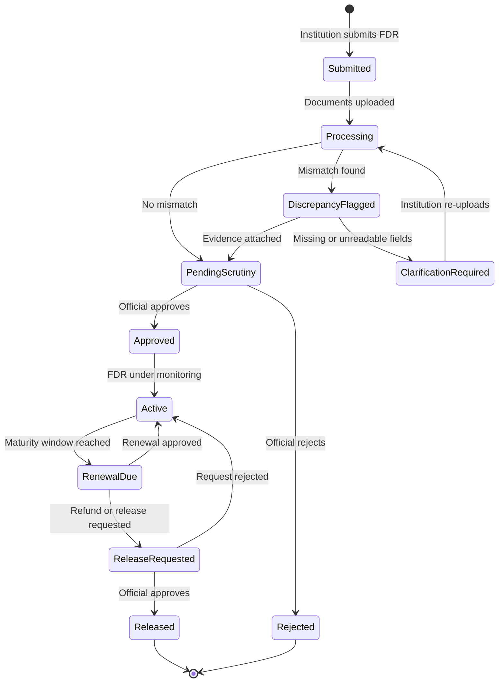
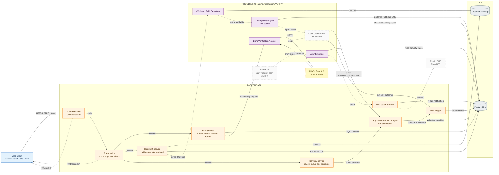

<div align="center">

# FDR Shield

### Intelligent FDR Lifecycle Management for Institutional Compliance
**From FDR submission to verified closure.**


A role-based portal that digitizes the lifecycle of institutional security deposits and Fixed Deposit Receipts (FDRs) for AICTE: submission, document intelligence, discrepancy detection, official scrutiny, maturity monitoring, and renewal or release.


[Live Demo](#demo-access) · [Walkthrough](#product-walkthrough) · [Architecture](#system-architecture) · [Quick Start](#quick-start) · [Roadmap](#roadmap)

</div>

> **Disclaimer.** FDR Shield is a hackathon project. It is **not** an official AICTE product and is **not** connected to AICTE systems or live banking infrastructure. Bank verification is performed by a **mock service** for demonstration.

<!--
  HERO IMAGE: replace this comment with a genuine screenshot of the dashboard or scrutiny workspace.
  Example:  <p align="center"></p>
  Do not add the line until the file exists.
-->

---

## Contents

1. [Demo Access](#demo-access)
2. [The Problem](#the-problem)
3. [Our Approach](#our-approach)
4. [Key Capabilities](#key-capabilities)
5. [Product Walkthrough](#product-walkthrough)
6. [How the Workflow Works](#how-the-workflow-works)
7. [System Architecture](#system-architecture)
8. [Technology Stack](#technology-stack)
9. [User Roles and Permissions](#user-roles-and-permissions)
10. [Quick Start](#quick-start)
11. [Implementation Status](#implementation-status)
12. [Security and Data Integrity](#security-and-data-integrity)
13. [Repository Structure](#repository-structure)
14. [Roadmap](#roadmap)
15. [Known Limitations](#known-limitations)
16. [Contributing](#contributing)
17. [License](#license)
18. [Team and Acknowledgments](#team-and-acknowledgments)

---

## Demo Access

| Resource | Link |
|---|---|
| Live application | `TODO: add URL, or state "runs locally; see Quick Start"` |
| API documentation | `TODO: add URL if exposed (e.g. /docs)` |
| Demo video | `TODO: add link` |
| Presentation | `TODO: add link` |

**Demo accounts:** list only intentionally seeded demo accounts here, with their role and limitations. Never publish real credentials.

---

## The Problem

Managing institutional security deposits held as FDRs involves several recurring administrative challenges. This project is built around them. They are framed as a design context, not as verified findings about any specific institution.

| Operational Challenge | FDR Shield Capability |
|---|---|
| Scattered FDR records | Centralized FDR registry |
| Manual comparison of documents with declared details | OCR-assisted discrepancy detection |
| Unclear case progress | Lifecycle status and scrutiny queue |
| Maturity follow-up complexity | Deadline monitoring and alerts |
| Limited decision traceability | Audit records and approval history |
| Repetitive institution-official coordination | Structured clarification and request workflows |

> Keep only the rows the codebase actually supports.

## Our Approach

FDR Shield treats FDR handling as an **integrated workflow** rather than a document upload portal:

- **Structured submission** of declared FDR details with supporting documents.
- **Document intelligence:** OCR extraction compared against declared values, with evidence for every mismatch.
- **Human-led decisions:** automation recommends and routes; authorized officials approve or reject.
- **Lifecycle tracking** from submission through maturity, renewal, and release.
- **Auditable history** of consequential actions.

OCR output supports review but does not prove document authenticity.

---

## Key Capabilities

### Document Intelligence
Uploaded FDR documents are processed by OCR, normalized, and compared with institution-declared values (FDR number, bank, amount, dates, branch, where supported). Missing or unreadable fields are flagged for manual review. *Status: see [Implementation Status](#implementation-status).*

### Official Scrutiny Workspace
Authorized AICTE Officials review submissions, inspect discrepancy evidence, and record approval or rejection decisions.

### FDR Lifecycle Management
Cases move through defined states, from submission and scrutiny to active monitoring, renewal, and release or closure.

### Maturity Monitoring
Maturity and expiry dates are tracked with configurable deadline alerts. Document which stages are implemented before publishing.

### Mock Bank Verification
A bank verification adapter calls a **simulated** bank service. It demonstrates the integration pattern and does not verify against any real bank.

### Role-Based Access and Account Approval
Institutions, AICTE Officials, and Super Admins have distinct permissions. New accounts stay pending until approved. Authorization is enforced by the backend, not only by hidden frontend routes.

---

## Product Walkthrough

> No screenshots are referenced yet, because none were available to verify. Capture genuine screens from the running app, place them under `docs/assets/`, and replace each placeholder with an image link.

| # | Screen | Suggested file | What to highlight |
|---|---|---|---|
| 1 | Dashboard and FDR overview | `docs/assets/dashboard-overview.png` | Lifecycle states at a glance |
| 2 | Institution FDR submission | `docs/assets/fdr-submission.png` | Declared details and document upload |
| 3 | Document discrepancy analysis | `docs/assets/document-discrepancy.png` | Declared vs extracted values |
| 4 | Official scrutiny and approval | `docs/assets/scrutiny-workspace.png` | Evidence and decision controls |
| 5 | Maturity and renewal tracking | `docs/assets/maturity-monitoring.png` | Upcoming deadlines |
| 6 | Administrative account approval | `docs/assets/admin-approvals.png` | Pending registrations |

---

## How the Workflow Works

The lifecycle below uses **proposed state names**. Align them with the enum values in the code.



---

## System Architecture

**Legend:** solid = implemented (verify) · yellow dashed = simulated · grey dotted = planned. Items marked `VERIFY` must be confirmed against the code.

### Diagram 1: System Architecture

```mermaid
flowchart TB
    subgraph CLIENT["CLIENT / ACCESS LAYER"]
        direction LR
        INST["Institution / College<br/>Registers, submits FDRs"]
        OFF["AICTE Official<br/>Scrutiny and review"]
        SADM["Super Admin<br/>Highest authority"]
        BROWSER["Web Browser<br/>HTTPS only"]
    end

    subgraph FE["FRONTEND LAYER  -  framework: VERIFY"]
        direction LR
        FE_AUTH["Auth and Registration<br/>Login, pending-approval state"]
        FE_INST["Institution Dashboard<br/>FDR Submission and Tracking<br/>Document Upload"]
        FE_OFF["Scrutiny Queue<br/>FDR Review Workspace"]
        FE_ADM["Admin User Management<br/>Account Approvals"]
        FE_COM["Maturity Calendar<br/>Renewal and Refund<br/>Notifications, Audit History"]
    end

    subgraph BE["BACKEND LAYER  -  Python REST API (FastAPI assumed: VERIFY)"]
        direction TB
        GW["API Entry Point<br/>Validation, CORS, error handling"]
        MW["Auth Middleware<br/>Token validation"]
        RBAC["RBAC and Account-Status Guard<br/>Server-side enforcement<br/>role + approved status"]
        subgraph ROUTERS["Routers / Service Modules  -  confirm against repo"]
            direction LR
            R_ACC["Accounts<br/>Institution and Official"]
            R_FDR["FDR Lifecycle<br/>Submission, status"]
            R_DOC["Documents<br/>Upload, retrieval"]
            R_SCR["Scrutiny and Approval<br/>Decisions"]
            R_REN["Renewal and Refund<br/>Requests"]
            R_NOT["Notifications"]
            R_AUD["Audit Log"]
            R_ADM["Admin Operations"]
        end
    end

    subgraph AI["PROCESSING AND AUTOMATION LAYER  -  deterministic unless stated"]
        direction LR
        OCRSVC["Document Intelligence<br/>OCR + field normalization<br/>OCR engine: VERIFY"]
        DISC["Discrepancy Detection Engine<br/>Rule-based comparison<br/>declared vs extracted"]
        BANKAD["Bank Verification Adapter<br/>Replaceable interface"]
        POLICY["Approval and Policy Engine<br/>Workflow transitions<br/>human approval required"]
        MAT["Maturity Monitoring Engine<br/>Deadline calculation, alerts<br/>scheduler: VERIFY"]
        ORCH["FDR Case Orchestrator<br/>State tracking, routing,<br/>overdue escalation"]
    end

    subgraph INFRA["DATA AND INFRASTRUCTURE LAYER"]
        direction LR
        PG[("PostgreSQL<br/>Users, institutions, FDRs,<br/>states, approvals,<br/>discrepancies, notifications")]
        ORM["SQLAlchemy ORM<br/>+ migrations: VERIFY"]
        STORE[("Document Storage<br/>Uploaded FDR files<br/>type: VERIFY")]
        AUDITDB[("Audit Events<br/>Append-only records")]
        JOBS["Scheduled Jobs<br/>Maturity scans<br/>mechanism: VERIFY"]
        LOGS["Application Logs"]
    end

    subgraph EXT["EXTERNAL SERVICES LAYER"]
        direction LR
        MOCKBANK["MOCK Bank Verification API<br/>SIMULATED - not a live bank"]
        NOTIFEXT["Email / SMS Provider<br/>PLANNED unless verified"]
        REALBANK["Real Bank / Government Adapters<br/>PLANNED - requires authorization"]
    end

    INST --> BROWSER
    OFF --> BROWSER
    SADM --> BROWSER
    BROWSER -->|"HTTPS"| FE_AUTH
    BROWSER -->|"HTTPS"| FE_INST
    BROWSER -->|"HTTPS"| FE_OFF
    BROWSER -->|"HTTPS"| FE_ADM
    BROWSER -->|"HTTPS"| FE_COM

    FE_AUTH -->|"REST / JSON"| GW
    FE_INST -->|"REST / JSON, multipart upload"| GW
    FE_OFF -->|"REST / JSON"| GW
    FE_ADM -->|"REST / JSON"| GW
    FE_COM -->|"REST / JSON"| GW

    GW --> MW --> RBAC --> ROUTERS

    R_DOC -->|"enqueue / invoke"| OCRSVC
    OCRSVC -->|"extracted fields"| DISC
    DISC -->|"discrepancy report"| ORCH
    R_FDR -->|"verification request"| BANKAD
    BANKAD -->|"HTTP"| MOCKBANK
    MOCKBANK -->|"mock result"| BANKAD
    BANKAD -->|"verification result"| ORCH
    ORCH -->|"route for scrutiny"| POLICY
    R_SCR -->|"decision request"| POLICY
    POLICY -->|"state transition"| R_FDR
    JOBS -->|"periodic trigger"| MAT
    MAT -->|"alerts, follow-ups"| R_NOT
    R_NOT -.->|"planned"| NOTIFEXT
    BANKAD -.->|"future swap"| REALBANK

    ROUTERS --> ORM --> PG
    R_DOC -->|"file write / read"| STORE
    R_AUD --> AUDITDB
    POLICY -->|"decision + evidence"| AUDITDB
    ORCH -->|"action + outcome"| AUDITDB
    GW --> LOGS

    classDef client fill:#E3F2FD,stroke:#1565C0,color:#0D2B52
    classDef frontend fill:#E8F5E9,stroke:#2E7D32,color:#123315
    classDef backend fill:#FFF3E0,stroke:#EF6C00,color:#4A2800
    classDef engine fill:#F3E5F5,stroke:#7B1FA2,color:#2E0B3A
    classDef data fill:#ECEFF1,stroke:#455A64,color:#17242B
    classDef sim fill:#FFF9C4,stroke:#F9A825,stroke-dasharray:5 3,color:#4A3B00
    classDef plan fill:#FAFAFA,stroke:#9E9E9E,stroke-dasharray:2 4,color:#555555

    class INST,OFF,SADM,BROWSER client
    class FE_AUTH,FE_INST,FE_OFF,FE_ADM,FE_COM frontend
    class GW,MW,RBAC,R_ACC,R_FDR,R_DOC,R_SCR,R_REN,R_NOT,R_AUD,R_ADM backend
    class OCRSVC,DISC,BANKAD,POLICY,MAT engine
    class ORCH plan
    class PG,ORM,STORE,AUDITDB,JOBS,LOGS data
    class MOCKBANK sim
    class NOTIFEXT,REALBANK plan
```



### Diagram 2: Service Communication and Data Flow

Solid arrows are **synchronous**. Dotted arrows are **asynchronous or scheduled**.



### Diagram 3: FDR Case Lifecycle

See the state diagram under [How the Workflow Works](#how-the-workflow-works).

---

## Technology Stack

> Fill from `package.json` and `requirements.txt`. List only what the repository uses.

| Layer | Technology | Responsibility |
|---|---|---|
| Frontend | `VERIFY` | User interface for all three roles |
| Backend | Python REST API (`VERIFY`: FastAPI) | API, business rules, authorization |
| Database | PostgreSQL | Users, FDRs, workflow states, approvals, audit events |
| ORM | SQLAlchemy (`VERIFY`: migrations tool) | Data access |
| Document processing | `VERIFY` (OCR engine) | Field extraction |
| Verification | Mock bank service | **Simulated** verification |
| Background processing | `VERIFY` (scheduler or task system) | Maturity scans, OCR jobs |
| Deployment | `VERIFY` | Hosting |

## User Roles and Permissions

| Role | Registration | Capabilities |
|---|---|---|
| **Institution / College** | Public registration; pending until approved by an AICTE Official or Super Admin | Submit FDRs, upload documents, track status, request renewal or release |
| **AICTE Official** | Pending until approved by Super Admin | Scrutinize applications and FDRs, approve or reject per permissions |
| **Super Admin** | Provisioned | Highest authority; approves or rejects Official and Institution accounts |

Only approved users can access protected functionality. The backend enforces this on every protected API.

---

## Quick Start

> Commands below are **unverified templates**. Replace each with the repository's actual command and remove this note once tested.

### Prerequisites

- Node.js `VERIFY version`
- Python `VERIFY version`
- PostgreSQL `VERIFY version`

### 1. Clone

```bash
git clone https://github.com/<owner>/<repo>.git
cd <repo>
```

### 2. Configure environment

```bash
cp .env.example .env
```

Document each required variable by name only (database URL, token secret, storage path, mock bank URL). Never commit real values.

### 3. Backend

```bash
cd backend
python -m venv venv && source venv/bin/activate   # Windows: venv\Scripts\activate
pip install -r requirements.txt
# VERIFY: migration command
# VERIFY: start command
```

### 4. Mock bank service

```bash
# VERIFY: start command, or note that it runs inside the backend
```

### 5. Frontend

```bash
cd frontend
npm install
npm run dev   # VERIFY script name
```

---

## Implementation Status

Statuses are provisional until checked against the code.

| Capability | Status | Notes |
|---|---|---|
| Registration, login, account approval | Implemented | Verify pending-state enforcement |
| Role-based access (backend) | Implemented | Verify on every router |
| FDR submission and document upload | Implemented | Verify file validation |
| OCR extraction | Partial | Identify engine and supported formats |
| Discrepancy detection | Partial | List fields actually compared |
| Bank verification | Simulated | Mock service only |
| Scrutiny and approval | Implemented | |
| Maturity alerts | Partial | State which deadline stages exist |
| Renewal and refund requests | Partial | |
| Notifications | Partial | In-app only unless verified |
| Audit trail | Partial | Verify coverage |
| Automated case orchestration | Planned | Proposed extension |
| Email / SMS provider | Planned | |
| Real bank or AICTE integration | Planned | Requires authorization |

OCR, discrepancy detection, and policy checks are conventional, rule-based components. No LLM agents are used.

## Security and Data Integrity

Document only controls confirmed in the code. Intended design:

- HTTPS between clients and API; restricted CORS.
- Token validation and account-status checks on protected endpoints.
- Backend RBAC; frontend route guards are UX only.
- Object-level access: institutions see only their own FDRs and documents.
- Upload validation (type, size, safe file names).
- Append-only audit events for consequential actions.
- Secrets in environment variables, never committed.
- OCR values are **extracted text, not verified bank data**.

This project has not been penetration-tested and makes no claim of encryption at rest or regulatory certification.

## Repository Structure

```text
<repo>/
├── frontend/     # VERIFY: web client
├── backend/      # VERIFY: REST API, models, services
├── mock-bank/    # VERIFY: simulated bank service
├── docs/         # Architecture notes and screenshots
└── README.md
```

Replace with the actual tree.

## Roadmap

- [ ] Persisted case orchestrator with transition history and overdue escalation
- [ ] Background workers for OCR
- [ ] Bank adapter interface (`MockBankClient` now, authorized real client later)
- [ ] OCR confidence scoring with manual-review routing
- [ ] Configurable maturity alert stages
- [ ] Email / SMS notifications
- [ ] Tamper-evident audit log
- [ ] Docker Compose deployment
- [ ] Automated authorization and IDOR tests
- [ ] Accessibility review

## Known Limitations

- Bank verification is simulated.
- No connection to AICTE systems.
- OCR accuracy depends on document quality and is not an authenticity check.
- `TODO: add limitations found during repository audit`

## Contributing

Issues and pull requests are welcome. Please open an issue to discuss significant changes first.

## License

Released under the [MIT License](LICENSE). Copyright (c) 2026 `<Your Name or Team Name>`.

## Team and Acknowledgments

| Name | Role |
|---|---|
| `TODO` | `TODO` |

Smart India Hackathon `<year>` · Problem Statement `<ID>`
