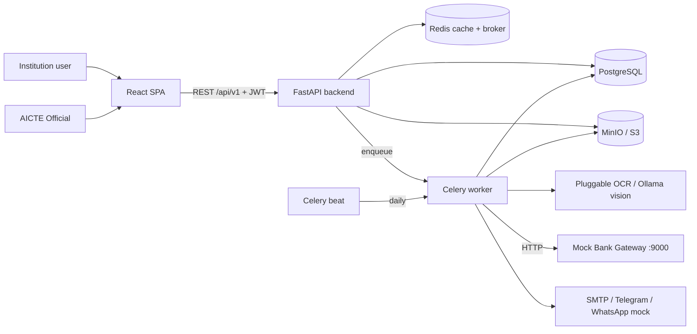

# FDR-Shield: HLD & LLD

AI-powered centralized Security Deposit & FDR management portal for AICTE.
Stack: **FastAPI + React (Vite)**, PostgreSQL, Redis + Celery, MinIO (S3), optional OCR/LLM providers, **demo bank gateway**. The Compose example configures Ollama Cloud for OCR; the separate agent LLM provider is disabled until configured. Without usable provider credentials, manual field entry and deterministic assistant/ML fallbacks remain available. The default installation has no torch/GPU/ML dependencies.

---

## PART 1: HIGH-LEVEL DESIGN (HLD)

### 1.1 Goals
| Goal | How |
|---|---|
| Central FDR lifecycle (submit, scrutiny, renew, release) | `fdrs`, `refunds` modules + status state machine |
| USP 1: OCR + fraud detection | `ocr_service` + `fraud_service` run in a Celery task |
| USP 2: Multi-tier escalation | Celery beat daily scan; T-90 / T-30 / T-0 / escalated |
| USP 3: Bank verification + trust badge | `mock_bank_api` (DEMO CBS) + `trust_score_service` |
| Role-based access + full audit | JWT + TOTP MFA + RBAC; append-only `audit_logs` |

### 1.2 Free / demo replacements for paid services
| Blueprint item | We use | Note |
|---|---|---|
| AWS Textract / Google Vision | `ollama_vision` OCR adapter | Compose uses Ollama Cloud `https://ollama.com`; `OLLAMA_API_KEY` is required for cloud use; failures preserve unverified records and allow manual field entry |
| LLM agent provider | Separately configurable OpenAI-compatible endpoint | Disabled by default; uses only `COMMAND_LLM_API_URL`, `COMMAND_LLM_MODEL`, and `COMMAND_LLM_API_KEY`; deterministic command and assistant fallbacks remain active on provider failure |
| Optional offline OCR | EasyOCR or Tesseract adapters | Install `requirements-ml.txt` explicitly; neither is in Docker/default requirements |
| AWS S3 | **MinIO** | S3 compatible via boto3; swap endpoint for prod |
| Twilio / Gupshup WhatsApp | **Telegram Bot API** + `whatsapp_mock` outbox | WhatsApp is demoed via a mock adapter |
| SendGrid / SES | **SMTP** (Mailhog in dev, any free SMTP in prod) | |
| Bank CBS APIs | **`mock_bank_api`** standalone FastAPI (SBI/PNB/HDFC adapters) | DEMO only, seeded JSON |
| DigiLocker / APAAR | `digilocker_mock` | Static fixtures |
| Redis + BullMQ | Redis + **Celery** (Python-native) | |
| Next.js | **React + Vite** | As requested |

### 1.3 System context



### 1.4 Deployment (docker-compose, single host)
`frontend:5173`, `backend:8000`, `mock-bank:9100`, `worker`, `beat`, `postgres`, `redis`, `minio:9000/9001`, `mailhog:8025`. Compose retains `chainguard/minio:latest`, sets the root credentials from the S3 env values, persists `/data` in `minio-data`, checks `/minio/health/live`, and retries bucket setup at startup. For no-Docker development, `STORAGE_BACKEND=local` uses a local folder with five-minute signed document URLs.
Scale path: put NGINX in front, run N backend replicas and M workers (stateless; state lives in PG/Redis/S3).

### 1.5 Key flows

**A. FDR submission and auto-verification (USP 1 + 3)**
```mermaid
sequenceDiagram
  participant U as Institution
  participant API as FastAPI
  participant S3 as MinIO
  participant Q as Redis/Celery
  participant W as Worker
  participant MB as Mock Bank
  U->>API: POST /fdrs (form + scan)
  API->>S3: store scan (MinIO credentials; transport protected in deployment)
  API->>API: insert FDR (SUBMITTED, 🟡 self_declared) + audit
  API->>Q: enqueue run_verification_pipeline(fdr_id)
  API-->>U: 201 {fdr_id}
  W->>S3: fetch scan
  W->>W: OCR engine (Ollama vision by default) -> validate fields
  W->>MB: POST /{bank}/v1/fdr/verify
  W->>W: fraud compare (declared vs OCR vs bank)
  W->>API/DB: save discrepancies, badge (🟢/🟡/🔴), status, audit
  U->>API: poll GET /verification/{id}/report
```

**B. Escalation scheduler (USP 2)**
Celery beat at 02:00 daily runs `scan_maturities`: for each active FDR compute `days_left`, map to stage (`<=90` T-90, `<=30` T-30, `<=0` T-0). If stage is new for that FDR, dispatch email + Telegram + WhatsApp-mock and write a `notifications` row (idempotent). At T-0 with no renewal: escalate to AICTE Officials and set FDR `EXPIRED` once past maturity.

**C. Scrutiny (split viewer)**: AICTE Official opens `/official/scrutiny/:id`; UI loads FDR, report and presigned URL, shows scan left and Declared/OCR/Bank comparison right; approve sets `VERIFIED`, request-correction sets `MISMATCH`.

**D. Refund / release**: institution raises request (only if VERIFIED and matured/closed) -> AICTE Official approves/rejects with rationale -> FDR `RELEASED` only on approval.

### 1.6 FDR state machine
```
SUBMITTED -> UNDER_SCRUTINY -> VERIFIED -> RELEASE_REQUESTED -> RELEASED
     |              |             |
     v              v             +-> RENEWAL_REQUESTED -> (new FDR linked, old closed)
  MISMATCH <--------+             +-> EXPIRED (maturity passed, no renewal)
MISMATCH -> UNDER_SCRUTINY (after resolution)
```
Allowed transitions live in one dict `ALLOWED_TRANSITIONS` in `fdr_service.py`.

Phase 1 adds orthogonal state dimensions while retaining `fdrs.status` as the legacy API/business compatibility field. `lifecycle_state` projects the business phase; `execution_state` reports orchestrator execution; `authorization_state` records human gates; and `verification_level` identifies evidence provenance. `workflow_instances` is authoritative for lifecycle/execution/authorization after import; the matching FDR columns are a denormalized read projection during the compatibility period. Legacy records are imported as `execution_state=not_started` because the former task runner did not persist node-level traces. OCR/mock-bank values are never labelled as `VERIFIED_EXTERNAL` or `HUMAN_SCRUTINIZED` unless supported by the corresponding source/decision.

### 1.7 Non-functional
| Concern | Decision |
|---|---|
| Security | 15-minute JWT access cookies + rotated DB-backed refresh sessions, CSRF, TOTP MFA, RBAC, presigned URLs 5 min, Argon2id (legacy bcrypt upgrade) |
| Auditability | Append-only `audit_logs` (user_id, ip, entity, action, delta_changes, timestamp); no update/delete code path |
| Performance | OCR/emails async in Celery; dashboard stats cached in Redis 60 s; indexes on `maturity_date`, `fdr_number` |
| Reliability | Idempotent alerts via `(fdr_id, stage)` uniqueness; Celery retries with backoff |
| Extensibility | Bank adapters and OCR engines behind small interfaces |

### 1.7.1 Roles
| Role | Can |
|---|---|
| `institution` | Submit/view own FDRs, renewal, refund claim |
| `aicte_official` | Queue, split view, status changes, discrepancy resolution, refund decisions, audit logs |
| `admin` (Super Admin compatibility value) | One-time bootstrap; invite/manage users; approve/reject AICTE Official and Institution applications; override verified public application decisions; system settings, reports, workflows and audit |

Institution and AICTE Official applicants self-register and enter their approval queues immediately; email verification is temporarily disabled. AICTE Officials decide Institution applications; Super Admins approve/reject AICTE Official applications and may decide Institution applications directly. Super Admin may override public application decisions. A one-time first-Super-Admin setup page requires a backend-only `SUPER_ADMIN_SETUP_SECRET`; it is unavailable if unset and permanently closes when any Super Admin row exists. There is no public path to create additional Super Admins. Existing database role `admin` remains the stored Super Admin role value for compatibility.

---

## PART 2: LOW-LEVEL DESIGN (LLD)

### 2.1 Database schema

```
users(id PK, email UQ, password_hash?, role, institution_id FK?, account status, lockout, session version, encrypted MFA secret)
institutions(id PK, aicte_id UQ, name, state, head_name, contact_email, contact_phone, telegram_chat_id?)
fdrs(id PK, institution_id FK, fdr_number IDX, bank_name, branch, amount NUM(14,2),
      issue_date, maturity_date IDX, status (legacy), lifecycle_state?, execution_state?, authorization_state?, verification_level?, trust_badge,
      declared_data JSON, ocr_data JSON?, bank_data JSON?, is_synthetic BOOLEAN NULL (NULL=legacy provenance unknown),
     last_alert_stage?, replaces_fdr_id FK?)
documents(id PK, fdr_id FK, doc_type, s3_key, content_type, uploaded_by FK, version_no, sha256?, supersedes_document_id?)
discrepancies(id PK, fdr_id FK, field, declared_value, extracted_value, source, severity, resolved)
notifications(id PK, fdr_id FK, stage, channel, recipient, status, sent_at)  UQ(fdr_id, stage, channel)
refund_requests(id PK, fdr_id FK, requested_by FK, status, reviewed_by?, remarks?)
audit_logs(id PK, user_id?, entity, entity_id, action, ip_address, delta_changes JSON, created_at)
         plus previous_hash / record_hash; audit_chain_heads is a locked singleton chain watermark
verification_runs(id PK, fdr_id FK, document_id?, extraction_engine, source, verification_level,
                  declared_snapshot JSON, extracted_fields JSON?, bank_result JSON?, discrepancies JSON)
workflow_instances(id PK, fdr_id FK, institution_id FK, workflow_version, execution_version,
                   lifecycle_state, execution_state, authorization_state, current_node?, next_wake_at?, version)
workflow_node_executions(id PK, workflow_instance_id FK, node_key, attempt, status,
                         input/output refs, error fields, idempotency_key?, timestamps, replay lineage)
workflow_events(id PK, workflow_instance_id FK, event_type, payload JSON, dedupe_key UQ, received_at, processed_at?)
workflow_checkpoints(id PK, workflow_instance_id FK, node_execution_id FK?, schema_version, state_snapshot JSON, created_at)
outbox_events(id PK, aggregate_id, event_type, payload JSON, idempotency_key UQ, status, attempts, next_attempt_at)
approval_records(id PK, workflow_instance_id FK, fdr_id FK, request_type, decision, rationale, actor_user_id FK, actor_role)
exception_items(id PK, workflow_instance_id FK, reason_code, priority, due_at?, status, evidence_refs JSON)
correction_requests(id PK, workflow_instance_id FK, fdr_id FK, requested_by FK, reason, required_fields JSON, due_at?, status)
automation_rules / automation_rule_versions (versioned policy JSON)
command_executions(id PK, user_id FK, raw_command, interpreted_plan JSON?, authorization_result JSON?, status)
notification_delivery_attempts(id PK, notification_id FK, attempt_no, provider, status, provider_response?, error?)
ml_model_versions / ml_demo_samples / ml_predictions / ml_operations_snapshots
```
Relations: Institution 1-N FDR/User; FDR 1-N Document / VerificationRun / Discrepancy / Notification / RefundRequest / WorkflowInstance; workflow instance 1-N node execution/event/checkpoint/approval/exception/correction; FDR self-reference via `replaces_fdr_id`.

### 2.2 REST API (prefix `/api/v1`)
| Method + path | Role | Purpose |
|---|---|---|
| POST `/auth/login`, `/auth/refresh`, `/auth/logout`; GET `/auth/me` | any / cookie session | One shared login; backend resolves the role from the account |
| POST `/auth/register/institution`, `/auth/register/official`, `/auth/register/super-admin`, `/auth/verify-email`, `/auth/forgot-password`, `/auth/reset-password` | public | Email-verified applicant onboarding, secret-gated one-time Super Admin setup, and one-time password recovery |
| GET `/institutions/registrations`, POST `/institutions/registrations/{id}/decision` | AICTE Official | Primary Institution approval/rejection queue |
| GET `/admin/registrations`, `/admin/official-registrations`; POST decision/override routes | Super Admin (`admin` stored value) | Official approval, direct Institution decisions, public application overrides |
| GET/POST `/institutions`, GET `/institutions/{id}`, `/institutions/{id}/fdrs` | AICTE Official / admin | Institution records |
| POST `/fdrs/extract-preview` (multipart), POST `/fdrs` (multipart) | institution | Preview OCR, then submit only after every field is confirmed |
| GET `/fdrs` (status, badge, institution_id) | all (scoped) | Trust Matrix |
| GET `/fdrs/{id}`, `/fdrs/{id}/presigned-url` | all (scoped) | Detail / scan URL |
| PATCH `/fdrs/{id}/status` | AICTE Official | Scrutiny decision |
| POST `/fdrs/{id}/renewal` | institution | Renewal / replacement |
| POST/GET `/documents/{fdr_id}` | all (scoped) | Extra docs |
| POST `/verification/{id}/run`, GET `/verification/{id}/report` | AICTE Official / all | Verification |
| GET `/verification/discrepancies`, POST `/verification/discrepancies/{id}/resolve` | AICTE Official / admin | Alert board |
| GET `/notifications`, POST `/notifications/test` | all / admin | Alerts + demo trigger |
| POST/GET `/refunds`, POST `/refunds/{id}/decision` | institution / AICTE Official | Release workflow |
| GET `/dashboard/bureau`, `/dashboard/institution` | AICTE Official / admin; institution | Stats |
| GET `/audit` | AICTE Official, admin | Audit trail |
| POST `/institution/assistant/messages` | institution | Institution-scoped assistance; server tools derive context, configured LLM phrases grounded answer |
| GET `/admin/operations/health`, `/failed-jobs`, `/stuck-cases`, `/delivery-failures`, `/recovery-recommendations` | admin | Read-only deterministic operations monitoring |
| POST `/admin/operations/actions/{requeue-failed-job|send-test-alert}` | admin | Confirmed, allowlisted operational actions only |
| POST `/commands/interpret` | AICTE Official / admin | LLM structured intent to allowlisted tools; plan still requires authorization and confirmation |
| GET/POST `/admin/rules`, POST `/admin/rules/{id}/versions` | admin | Append-only automation policy versions with audit records |
| GET `/institution/ml/recommendations` | institution | Own-case deterministic review suggestions only |
| GET `/workflows/recommendations` | AICTE Official | Rule-based priority suggestions only |
| GET `/admin/ml/gates`, POST `/admin/ml/gates/evaluate`, POST `/admin/ml/demo-data`, GET `/admin/ml/{registry,demo-samples,predictions}`, POST `/admin/ml/predictions/run` | admin | Gate 0, labeled synthetic demos, registry, advisory fallback inference |
| GET `/admin/audit/verify-chain`, GET `/admin/audit/export` | admin | Verify/download the hash-chained audit trail |

Institution upload previews OCR without persistence. The UI requires a per-field review confirmation; edits are marked `DECLARED`, untouched extracted values are marked `EXTRACTED`, and provenance plus confirmed field names are stored in `fdrs.declared_data` and audit logs. Current OCR confidence is document-level, so that score is shown on each populated field; missing fields are explicitly marked “Not found in document.”

Mock bank (separate service, `:9000`): `GET /banks`, `POST /{sbi|pnb|hdfc}/v1/fdr/verify`, `GET /{bank}/v1/fdr/{no}/status`.

### 2.3 Layering rules (backend)
`api/v1/*` (HTTP only, validation, RBAC) -> `services/*` (business logic, transactions, audit) -> `models/*` + `integrations/*`.
Routers never touch the DB directly; services never import FastAPI `Request`; workers call the same services as the API.

### 2.4 Core algorithms

**Fraud compare (`fraud_service.compare_records`)**
- Fields: `fdr_number`, `amount`, `maturity_date`, `bank_name`, `holder`.
- Exact match for number/amount/date; `rapidfuzz.fuzz.token_set_ratio >= 85` for names.
- Sources checked: declared vs OCR, declared vs bank, OCR vs bank.
- Severity: `fdr_number` / `amount` = high; the rest = low.

**Trust badge (`trust_score_service.compute_badge`)**
```
if any unresolved high discrepancy        -> 🔴 MISMATCH   (FDR status MISMATCH)
elif bank.found and bank.status == ACTIVE -> 🟢 BANK_VERIFIED (FDR status VERIFIED-ready)
else                                      -> 🟡 SELF_DECLARED
```

**OCR extraction and format screening**: `FdrExtractor.extract(pages)` returns the seven nullable document fields (`fdr_number`, `bank_name`, `branch`, `holder_name`, `amount`, `issue_date`, `maturity_date`) and may include optional `document_format` / `format_reason` advisory metadata. With `OCR_FORMAT_CHECK=true`, Ollama screens up to two candidate pages (max 1600 px) for a bank-neutral FDR-like document structure; it does not compare the candidate against a specific bank template. Results are `fdr_like`, `not_fdr_like`, or `uncertain`, and are shown in upload preview and official review. This visual screen is not evidence that a bank issued the receipt, that an account exists, or that funds are genuine. OCR extraction and field comparison continue even for a negative/uncertain format result; extracted values remain unverified and require user confirmation and normal backend validation. Exact known-negative image hashes are rejected before a model call. `OCR_REFERENCE_DIR` defaults to `reference_formats`, resolved from the backend root, and is used only for the known-negative fixtures. Bare Settings default to `OCR_ENGINE=disabled`; Compose selects `ollama_vision` and the API model name `gemma4:31b`. Temperature remains zero with one retry on invalid JSON. Dates normalize to ISO-8601; confidence is the populated-field fraction. Offline OCR adapters extract fields but report format screening as not checked.

**Adding a CNN OCR adapter**: implement the `FdrExtractor` protocol in `app/integrations/ocr/cnn_engine.py`, keep all model/runtime dependencies optional, add a selector branch to `get_engine()`, and add mocked adapter contract tests. Do not add the heavy runtime to the default Docker build.

**Alert stage**: `stage_for(days_left)`: `<=0` -> T-0; `<=30` -> T-30; `<=90` -> T-90; else none. Skip if `notifications` already has the stage.

### 2.4.1 Audit write
Every service mutation calls `audit_service.record(session, user_id, entity, entity_id, action, ip, delta)` inside the same transaction as the change.

### 2.4.2 Phase 13 ML gates and fallbacks
- Gate plans, features, missing-value policies, acceptance criteria and minimum real-data volumes are declared in `backend/app/services/ml_service.py` before any trainer can exist. Current runtime intentionally has no trainer or ML library and does not train models.
- `institution_dagmm` (`institution-fdr-v1`) counts only explicitly `is_synthetic=false` FDRs; target is unusual structured-pattern ranking, with a minimum of 1,000 complete clean records. Evaluation plan: blinded officer precision@k/calibration versus Isolation Forest and robust z-score. Fallback: deterministic review rules; UI wording is only “unusual pattern — review suggested.”
- `official_deephit` (`official-resolution-v1`) defines resolution as workflow `completed_at`; unresolved records are right-censored at extraction cutoff. Minimum: 500 resolved, 100 censored and a 90-day chronological span. Evaluation plan: chronological C-index, time-dependent AUC and calibration versus Cox/rule priority. Fallback: rule-based deadline priority.
- `admin_bocpd` (`admin-metrics-15m-v1`) needs at least 1,000 explicitly real metric snapshots spanning 30 days. Evaluation plan: false-positive rate/detection delay versus threshold rules. Development/test metric captures are synthetic and excluded. Fallback: deterministic operations thresholds.
- Admin may create labeled synthetic demo features in `ml_demo_samples`; all are `is_synthetic=true`, excluded from gate counts/hashes and shown with a synthetic banner. Registry demo versions state `DEMO_ONLY_NOT_TRAINED`; no synthetic model metrics are reported.
- “Eligible for training review” is not approval and never launches training. All current recommendations use deterministic fallbacks, are stored as advisory predictions, and never affect workflow state, trust, permissions, approvals, rejection, or release.
- Registrations capture the fixed seed, feature version, dataset hash, runtime-library manifest, acceptance criteria and real/synthetic row counts. There is no trained DAGMM, DeepHit or BOCPD version until a separate trainer meets its stated acceptance criteria.
- No ML inference provider is currently installed. Every use case remains on its named deterministic fallback; Gate 0 only measures data readiness and cannot activate model behavior.

### 2.4.2a Optional LLM agents and fallback
- `COMMAND_LLM_ENABLED=false` by default. When enabled with its own provider URL/model/key, the Command Center uses strict structured output and the institution assistant uses server-scoped tool results as grounded context. `OLLAMA_API_KEY` is reserved for OCR and is never reused for agent LLM calls.
- Missing endpoint/model, low-confidence or malformed model output, timeout, and provider errors use the deterministic command parser or existing assistant response. Unsupported requests remain refused. Plans still pass server-side allowlists, RBAC, entity resolution, drift checks and confirmation.
- Prompts/data are not logged. Frontend has no provider key; credentials stay in backend environment variables.

### 2.4.3 Phase 14 reliability and security controls
- Audit rows are SHA-256 chained over canonical record fields with a transaction-locked chain head. ORM guards and database UPDATE/DELETE triggers enforce append-only records; admin APIs verify and export the chain, and Celery writes a verified weekly export to configured private storage.
- Request IDs are validated, propagated into same-request audit rows and included in structured HTTP logs. Request logs omit body, query parameters, cookies, authorization headers and prompts.
- Expensive OCR preview, institution-assistant and command endpoints use Redis-backed per-identity rate limits, with a bounded per-process fallback when Redis is unavailable. Login/public-auth abuse also has existing database throttles.
- Uploads keep size, MIME and magic-byte validation. If `CLAMAV_HOST` is configured, a ClamAV INSTREAM scan runs before OCR/storage and fails closed on scanner outage; unconfigured environments explicitly do not claim an AV scan.
- Legacy rows with unrecorded origin have `is_synthetic=NULL` and are excluded from real-data gates. Seeded records and generated demo samples are explicitly synthetic.
- Backup/restore and retention durations remain policy-owner decisions. No compliance or production-readiness claim is made without operational evidence.

### 2.5 Frontend design
- Role-specific routes: `/institution/*`, `/official/*`, `/admin/*`; `/bureau/*` remains a compatibility route for existing links.
- Server state: TanStack Query (`hooks/*`). Client state: Zustand (`authStore`, `uiStore`).
- One credentialed Axios client (`api/client.js`) with HttpOnly cookies, refresh retry and CSRF header.
- Bureau dashboard: 4 MetricCards -> charts -> TrustMatrixTable. Scrutiny: `SplitViewer`.
- Verification polling: `useVerificationReport` refetches every 3 s while `ocr_data` is null.

### 2.6 Demo script (for judges)
1. Login as institution -> upload FDR scan -> watch badge go 🟡 -> 🟢 (mock bank match) or 🔴 (seeded mismatch).
2. Bureau login -> Scrutiny queue -> split view -> approve.
3. Admin hits `POST /notifications/test` -> show email in Mailhog (:8025) + Telegram.
4. Show Audit Logs page with delta diffs.

### 2.7 Risks and mitigations
| Risk | Mitigation |
|---|---|
| OCR accuracy on poor scans or service outage | Resize pages, show confidence; OCR failures leave FDR submitted/yellow and allow AICTE Official review |
| Vision model availability | Mock OCR calls in tests; optionally choose EasyOCR/Tesseract with the extra ML requirements |
| Time pressure | Build order in `02_MODULE_GUIDE.md` section 5 |
