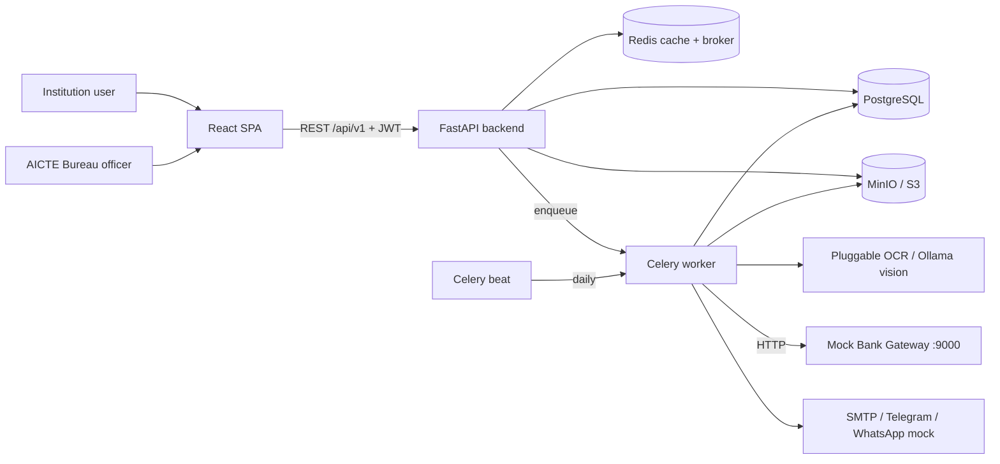

# FDR-Shield: HLD & LLD

AI-powered centralized Security Deposit & FDR management portal for AICTE.
Stack: **FastAPI + React (Vite)**, PostgreSQL, Redis + Celery, MinIO (S3), pluggable OCR with Ollama vision as the default, **demo bank gateway**. The default installation has no torch/GPU/ML dependencies. Optional EasyOCR/Tesseract adapters are selected explicitly.

---

## PART 1: HIGH-LEVEL DESIGN (HLD)

### 1.1 Goals
| Goal | How |
|---|---|
| Central FDR lifecycle (submit, scrutiny, renew, release) | `fdrs`, `refunds` modules + status state machine |
| USP 1: OCR + fraud detection | `ocr_service` + `fraud_service` run in a Celery task |
| USP 2: Multi-tier escalation | Celery beat daily scan; T-90 / T-30 / T-0 / escalated |
| USP 3: Bank verification + trust badge | `mock_bank_api` (DEMO CBS) + `trust_score_service` |
| Role-based access + full audit | JWT + TOTP MFA + RBAC; append-only `audit_logs` |

### 1.2 Free / demo replacements for paid services
| Blueprint item | We use | Note |
|---|---|---|
| AWS Textract / Google Vision | **Ollama vision API** (`gemma4:cloud` default) | Local Ollama sign-in or Ollama API key; mocked in tests |
| Optional offline OCR | EasyOCR or Tesseract adapters | Install `requirements-ml.txt` explicitly; neither is in Docker/default requirements |
| AWS S3 | **MinIO** | S3 compatible via boto3; swap endpoint for prod |
| Twilio / Gupshup WhatsApp | **Telegram Bot API** + `whatsapp_mock` outbox | WhatsApp is demoed via a mock adapter |
| SendGrid / SES | **SMTP** (Mailhog in dev, any free SMTP in prod) | |
| Bank CBS APIs | **`mock_bank_api`** standalone FastAPI (SBI/PNB/HDFC adapters) | DEMO only, seeded JSON |
| DigiLocker / APAAR | `digilocker_mock` | Static fixtures |
| Redis + BullMQ | Redis + **Celery** (Python-native) | |
| Next.js | **React + Vite** | As requested |

### 1.3 System context



### 1.4 Deployment (docker-compose, single host)
`frontend:5173`, `backend:8000`, `mock-bank:9100`, `worker`, `beat`, `postgres`, `redis`, `minio:9000/9001`, `mailhog:8025`. Compose retains `chainguard/minio:latest`, sets the root credentials from the S3 env values, persists `/data` in `minio-data`, checks `/minio/health/live`, and retries bucket setup at startup. For no-Docker development, `STORAGE_BACKEND=local` uses a local folder with five-minute signed document URLs.
Scale path: put NGINX in front, run N backend replicas and M workers (stateless; state lives in PG/Redis/S3).

### 1.5 Key flows

**A. FDR submission and auto-verification (USP 1 + 3)**
```mermaid
sequenceDiagram
  participant U as Institution
  participant API as FastAPI
  participant S3 as MinIO
  participant Q as Redis/Celery
  participant W as Worker
  participant MB as Mock Bank
  U->>API: POST /fdrs (form + scan)
  API->>S3: store scan (MinIO credentials; transport protected in deployment)
  API->>API: insert FDR (SUBMITTED, 🟡 self_declared) + audit
  API->>Q: enqueue run_verification_pipeline(fdr_id)
  API-->>U: 201 {fdr_id}
  W->>S3: fetch scan
  W->>W: OCR engine (Ollama vision by default) -> validate fields
  W->>MB: POST /{bank}/v1/fdr/verify
  W->>W: fraud compare (declared vs OCR vs bank)
  W->>API/DB: save discrepancies, badge (🟢/🟡/🔴), status, audit
  U->>API: poll GET /verification/{id}/report
```

**B. Escalation scheduler (USP 2)**
Celery beat at 02:00 daily runs `scan_maturities`: for each active FDR compute `days_left`, map to stage (`<=90` T-90, `<=30` T-30, `<=0` T-0). If stage is new for that FDR, dispatch email + Telegram + WhatsApp-mock and write a `notifications` row (idempotent). At T-0 with no renewal: mark `ESCALATED`, notify Bureau Chief, set FDR `EXPIRED` once past maturity.

**C. Scrutiny (split viewer)**: officer opens `/bureau/scrutiny/:id`; UI loads FDR, report and presigned URL, shows scan left and Declared/OCR/Bank comparison right; approve sets `VERIFIED`, reject sets `MISMATCH`.

**D. Refund / release**: institution raises request (only if VERIFIED and matured/closed) -> Bureau Chief approves -> FDR `RELEASED`.

### 1.6 FDR state machine
```
SUBMITTED -> UNDER_SCRUTINY -> VERIFIED -> RELEASE_REQUESTED -> RELEASED
     |              |             |
     v              v             +-> RENEWAL_REQUESTED -> (new FDR linked, old closed)
  MISMATCH <--------+             +-> EXPIRED (maturity passed, no renewal)
MISMATCH -> UNDER_SCRUTINY (after resolution)
```
Allowed transitions live in one dict `ALLOWED_TRANSITIONS` in `fdr_service.py`.

### 1.7 Non-functional
| Concern | Decision |
|---|---|
| Security | JWT (30 min), TOTP MFA, RBAC dependencies, presigned URLs 5 min, MinIO access credentials, bcrypt |
| Auditability | Append-only `audit_logs` (user_id, ip, entity, action, delta_changes, timestamp); no update/delete code path |
| Performance | OCR/emails async in Celery; dashboard stats cached in Redis 60 s; indexes on `maturity_date`, `fdr_number` |
| Reliability | Idempotent alerts via `(fdr_id, stage)` uniqueness; Celery retries with backoff |
| Extensibility | Bank adapters and OCR engines behind small interfaces |

### 1.7.1 Roles
| Role | Can |
|---|---|
| `institution` | Submit/view own FDRs, renewal, refund claim |
| `aicte_official` | Queue, split view, status changes, discrepancy resolution, refund decisions, audit logs |
| `admin` | Institutions CRUD, test alerts, everything read |

---

## PART 2: LOW-LEVEL DESIGN (LLD)

### 2.1 Database schema

```
users(id PK, email UQ, password_hash, role, institution_id FK?, totp_secret?, is_active)
institutions(id PK, aicte_id UQ, name, state, head_name, contact_email, contact_phone, telegram_chat_id?)
fdrs(id PK, institution_id FK, fdr_number IDX, bank_name, branch, amount NUM(14,2),
     issue_date, maturity_date IDX, status, trust_badge,
     declared_data JSON, ocr_data JSON?, bank_data JSON?,
     last_alert_stage?, replaces_fdr_id FK?)
documents(id PK, fdr_id FK, doc_type, s3_key, content_type, uploaded_by FK)
discrepancies(id PK, fdr_id FK, field, declared_value, extracted_value, source, severity, resolved)
notifications(id PK, fdr_id FK, stage, channel, recipient, status, sent_at)  UQ(fdr_id, stage, channel)
refund_requests(id PK, fdr_id FK, requested_by FK, status, reviewed_by?, remarks?)
audit_logs(id PK, user_id?, entity, entity_id, action, ip_address, delta_changes JSON, created_at)
```
Relations: Institution 1-N FDR; FDR 1-N Document / Discrepancy / Notification / RefundRequest; FDR self-reference via `replaces_fdr_id`.

### 2.2 REST API (prefix `/api/v1`)
| Method + path | Role | Purpose |
|---|---|---|
| POST `/auth/login`, `/auth/mfa/verify`, `/auth/mfa/setup`; GET `/auth/me` | any | Auth |
| GET/POST `/institutions`, GET `/institutions/{id}`, `/institutions/{id}/fdrs` | bureau / admin | Institution records |
| POST `/fdrs` (multipart) | institution | Submit FDR |
| GET `/fdrs` (status, badge, institution_id) | all (scoped) | Trust Matrix |
| GET `/fdrs/{id}`, `/fdrs/{id}/presigned-url` | all (scoped) | Detail / scan URL |
| PATCH `/fdrs/{id}/status` | officer, chief | Scrutiny decision |
| POST `/fdrs/{id}/renewal` | institution | Renewal / replacement |
| POST/GET `/documents/{fdr_id}` | all (scoped) | Extra docs |
| POST `/verification/{id}/run`, GET `/verification/{id}/report` | officer / all | Verification |
| GET `/verification/discrepancies`, POST `/verification/discrepancies/{id}/resolve` | officer, chief | Alert board |
| GET `/notifications`, POST `/notifications/test` | all / admin | Alerts + demo trigger |
| POST/GET `/refunds`, POST `/refunds/{id}/decision` | institution / chief | Release workflow |
| GET `/dashboard/bureau`, `/dashboard/institution` | bureau / institution | Stats |
| GET `/audit` | chief, admin | Audit trail |

Mock bank (separate service, `:9000`): `GET /banks`, `POST /{sbi|pnb|hdfc}/v1/fdr/verify`, `GET /{bank}/v1/fdr/{no}/status`.

### 2.3 Layering rules (backend)
`api/v1/*` (HTTP only, validation, RBAC) -> `services/*` (business logic, transactions, audit) -> `models/*` + `integrations/*`.
Routers never touch the DB directly; services never import FastAPI `Request`; workers call the same services as the API.

### 2.4 Core algorithms

**Fraud compare (`fraud_service.compare_records`)**
- Fields: `fdr_number`, `amount`, `maturity_date`, `bank_name`, `holder`.
- Exact match for number/amount/date; `rapidfuzz.fuzz.token_set_ratio >= 85` for names.
- Sources checked: declared vs OCR, declared vs bank, OCR vs bank.
- Severity: `fdr_number` / `amount` = high; the rest = low.

**Trust badge (`trust_score_service.compute_badge`)**
```
if any unresolved high discrepancy        -> 🔴 MISMATCH   (FDR status MISMATCH)
elif bank.found and bank.status == ACTIVE -> 🟢 BANK_VERIFIED (FDR status VERIFIED-ready)
else                                      -> 🟡 SELF_DECLARED
```

**OCR extraction**: `FdrExtractor.extract(pages)` returns six fields (`fdr_number`, `bank_name`, `holder_name`, `amount`, `issue_date`, `maturity_date`); missing values are null. The Ollama adapter sends at most two JPEG pages resized to 1600 px, requests constrained JSON at temperature 0, and retries once on invalid JSON. Dates normalize to ISO-8601; confidence is the populated-field fraction. Errors return an empty result, preserving SUBMITTED/yellow state.

**Adding a CNN OCR adapter**: implement the `FdrExtractor` protocol in `app/integrations/ocr/cnn_engine.py`, keep all model/runtime dependencies optional, add a selector branch to `get_engine()`, and add mocked adapter contract tests. Do not add the heavy runtime to the default Docker build.

**Alert stage**: `stage_for(days_left)`: `<=0` -> T-0; `<=30` -> T-30; `<=90` -> T-90; else none. Skip if `notifications` already has the stage.

### 2.4.1 Audit write
Every service mutation calls `audit_service.record(session, user_id, entity, entity_id, action, ip, delta)` inside the same transaction as the change.

### 2.5 Frontend design
- Router split by role; `RoleGuard` wraps `/institution/*` and `/bureau/*`.
- Server state: TanStack Query (`hooks/*`). Client state: Zustand (`authStore`, `uiStore`).
- One Axios client (`api/client.js`) with Bearer-token interceptor.
- Bureau dashboard: 4 MetricCards -> charts -> TrustMatrixTable. Scrutiny: `SplitViewer`.
- Verification polling: `useVerificationReport` refetches every 3 s while `ocr_data` is null.

### 2.6 Demo script (for judges)
1. Login as institution -> upload FDR scan -> watch badge go 🟡 -> 🟢 (mock bank match) or 🔴 (seeded mismatch).
2. Bureau login -> Scrutiny queue -> split view -> approve.
3. Admin hits `POST /notifications/test` -> show email in Mailhog (:8025) + Telegram.
4. Show Audit Logs page with delta diffs.

### 2.7 Risks and mitigations
| Risk | Mitigation |
|---|---|
| OCR accuracy on poor scans or service outage | Resize pages, show confidence; OCR failures leave FDR submitted/yellow and allow officer override |
| Vision model availability | Mock OCR calls in tests; optionally choose EasyOCR/Tesseract with the extra ML requirements |
| Time pressure | Build order in `02_MODULE_GUIDE.md` section 5 |
