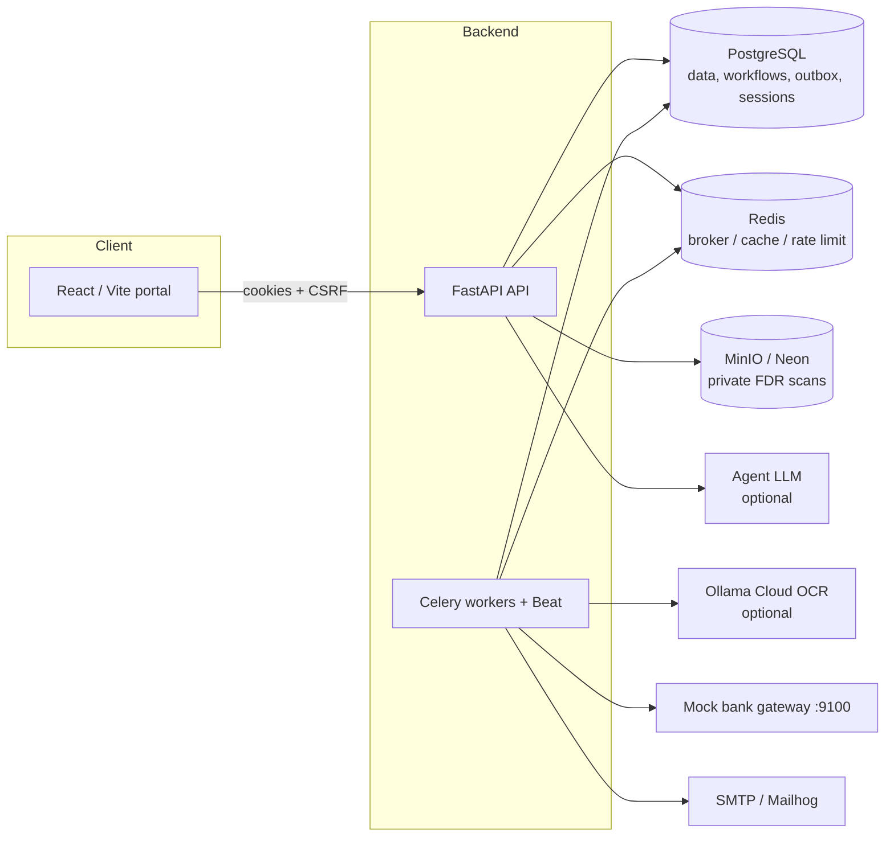

# NidhiTrack

<<<<<<< HEAD
AICTE security deposit and fixed deposit receipt (FDR) management demo. It uses FastAPI, async SQLAlchemy, PostgreSQL, Redis/Celery, MinIO, a React/Vite portal, optional Ollama Cloud OCR and a separately configurable LLM API for agents, plus a seeded demo bank gateway. The gateway is mock-only; no real bank systems are called. If a provider is unavailable or its key is absent, manual FDR entry and deterministic command/assistant/ML fallbacks remain available.
=======
**AICTE security-deposit & Fixed Deposit Receipt (FDR) management, with workflow automation, OCR-assisted verification and a guard-railed natural-language Command Center.**
>>>>>>> a27ee110f6ba3d79cb2eb0cff239996b7f97ea26

> ⚠️ **Demo system.** The bank gateway is a seeded **mock**: no real bank system is ever called. Verification results are advisory and do **not** prove document authenticity or constitute real-bank verification.

     

<<<<<<< HEAD
```powershell
docker compose up --build -d
docker compose exec backend alembic upgrade head
docker compose exec backend python -m scripts.seed
docker compose exec backend python -m scripts.backfill_workflows
docker compose exec backend python -m scripts.demo_flow
```

Open the frontend at http://localhost:5173, API docs at http://localhost:8000/docs, MinIO console at http://localhost:9001, Mailhog at http://localhost:8025, and the mock bank docs at http://localhost:9100/docs. Compose exposes its PostgreSQL service on host port 5434 by default (`POSTGRES_HOST_PORT` overrides it) to avoid colliding with a host database. Containers connect over Compose DNS at `postgres:5432`. The development seed includes synthetic demo data/accounts; production bootstrapping must use the one-time Admin CLI and account invitations.

The checked-in `backend/.env.example` contains development-only Compose values and no API keys. Set a random `JWT_SECRET` (at least 32 characters) in ignored `backend/.env` before starting the API; for example, generate one with `python -c "import secrets; print(secrets.token_urlsafe(48))"`. The default session lifetimes are `ACCESS_TOKEN_MINUTES=720` and `REFRESH_TOKEN_DAYS=30`. Refresh sessions are stored and rotated in the database; Redis is the broker/cache/rate-limit service, not the authentication session store. `OLLAMA_API_KEY` is only for Ollama OCR. The agent LLM has its own `COMMAND_LLM_API_URL`, `COMMAND_LLM_MODEL`, and `COMMAND_LLM_API_KEY`; it is disabled until you select/configure an LLM provider. Compose loads ignored `backend/.env` values as overrides. `S3_ENDPOINT` is the container-to-container storage address (`http://minio:9000`); `S3_PUBLIC_ENDPOINT` is used only to sign browser-readable links (`http://localhost:9000` in local Compose). Set the latter to the browser-reachable MinIO URL in other deployments. Never put keys in frontend variables or commit them. Demo seeding is blocked outside dev/test. For a non-demo database, migrate first, configure unique secrets, then run `python -m scripts.create_admin` once with `INITIAL_ADMIN_EMAIL` and `INITIAL_ADMIN_PASSWORD`; remove that password from the environment afterward. Production requires `APP_ENV=prod`, `COOKIE_SECURE=true`, a valid `MFA_ENCRYPTION_KEY`, `FRONTEND_ORIGIN`, and matching `CORS_ORIGINS` behind HTTPS. The bootstrap Admin must change the initial password.

After migrating an existing database, run the idempotent `backfill_workflows` script before relying on the new status projections. It imports a current-state snapshot only; legacy node-level run history cannot be reconstructed. New submissions enter a PostgreSQL-backed workflow via a transactional outbox; Celery executes extraction, validation and routing nodes, records checkpoints/errors, retries transient failures, waits for corrections/official review, and reclaims expired worker leases. Reminder/correction email delivery uses the outbox; ambiguous SMTP sends after a dispatcher crash are marked uncertain/dead rather than blindly resent. Workflow inspection/replay, SSE, Command Center, scoped assistance/operations agents and role-based screens are implemented in the current React app.

### Neon Object Storage for uploaded documents

The backend's S3-compatible adapter supports Neon Object Storage for FDR scans. In Neon, enable Object Storage for the target branch, create a **private** bucket, and create a credential with `storage:read` and `storage:write` scopes. Configure these backend-only environment variables on the API service:

```text
STORAGE_BACKEND=s3
S3_ENDPOINT=<branch S3 endpoint from Neon Storage connect details>
S3_REGION=<region from Neon Storage connect details>
S3_ACCESS_KEY=<Neon token_id / S3 access key ID>
S3_SECRET_KEY=<Neon s3_secret_access_key>
S3_BUCKET=<private bucket name>
S3_PUBLIC_ENDPOINT=
```

The endpoint and region are branch-specific. Leave `S3_PUBLIC_ENDPOINT` empty so short-lived signed document links use the same Neon endpoint. Never make FDR documents public or expose these credentials in frontend variables. Set the values in the backend host's secret environment configuration (for example, Render), not in committed files. The app uses path-style S3 requests and does not create public access; it checks the configured bucket at startup and attempts to create it if missing. Neon Object Storage and PostgreSQL are separate services, even when both belong to the same Neon project. See [Neon Object Storage setup](https://neon.com/docs/storage/get-started) and [S3 compatibility](https://neon.com/docs/storage/s3-compatibility).

## Verification, ML gates, and operations runbook

See [`docs/phase15-17-verification.md`](docs/phase15-17-verification.md) for test coverage, injection procedures, deployment/rollback steps, acceptance target status and the Phase 17 demo scope. Current local checks are `python -m pytest -q` from `backend`, plus `npm test` and `npm run build` from `frontend`. There is no configured frontend lint script. ML Gate 0 is available from Admin → ML governance / `/admin/ml`; models are not trained until real historical data volume and review criteria qualify. Seeded rows and generated examples are marked synthetic and excluded from real aggregate metrics.

To run a read-only authenticated concurrency check against a running API, set `LOAD_TEST_EMAIL` and `LOAD_TEST_PASSWORD` in the backend shell and run `python -m scripts.load_test_api`. Defaults are 100 concurrent readers and 5 rounds; set `LOAD_TEST_USERS` / `LOAD_TEST_ROUNDS` to adjust. It reports per-route p50/p95/p99 latency and errors without printing credentials or mutating records.

### Optional LLM agents

The agent LLM is disabled by default. To enable it, set `COMMAND_LLM_ENABLED=true` and configure the chosen provider’s `COMMAND_LLM_API_URL`, `COMMAND_LLM_MODEL`, and (if required) `COMMAND_LLM_API_KEY`. These are separate from Ollama OCR settings. Keep credentials out of frontend `VITE_*` variables. Ollama Cloud does not support structured outputs, so command intent JSON is requested in the prompt and then strictly validated server-side against the allowlist. For supported read-only FDR requests, the backend queries authorized records first and passes the bounded result to the LLM for a grounded answer; up to 200 maturity matches are returned per query, with larger totals counted and clearly marked as capped. If a provider is missing, unavailable, times out, or returns invalid output, the UI labels the deterministic, database-grounded response as a fallback. Mutating actions are server-authorized and follow each tool's confirmation policy.

Command Center access is available in all three portals. Institution users receive read-only queries scoped to their authenticated institution; AICTE Officials receive authorized read and workflow tools; Super Admin is read-only and does not receive financial approval or release authority through Command Center. Registered read tools cover total counts, latest FDR records, maturity searches, combined maturity/discrepancy analysis, workflow-state lists, FDR details/status, authorized task-status lookup, and failed-notification summaries. "Latest" records are ordered by descending database record ID because FDR rows do not store a creation timestamp. Registered official operations cover document rechecks, failed-node retries, workflow pause/resume, reminder drafts, and escalation. Case approval/rejection, release decisions, arbitrary administration, and free-form SQL are not Command Center tools.

Authentication uses separate Institution, AICTE Official, and Super Admin sign-in entry points backed by one shared role-derived SSO session. Existing `admin` role rows remain the stored Super Admin role for compatibility. Institution and AICTE Official applicants self-register and enter the appropriate approval queue immediately; email verification is temporarily disabled. Run `python -m alembic upgrade head` to move previously registered public applicants from `pending_email_verify` into the approval queue. Approved applicants can sign in with the password they set during registration. AICTE Officials decide Institution applications; Super Admins decide AICTE Official applications and may also decide Institution applications. The first Super Admin can be created at `/super-admin/setup` only when `SUPER_ADMIN_SETUP_SECRET` is configured in `backend/.env`; setup closes permanently once an Admin/Super Admin row exists. For local Compose, set a unique random value in the ignored `backend/.env`, recreate the backend with `docker compose up -d backend`, and enter that same value in the setup form. Remove the secret from the environment after setup. This page uses the same database lock as `python -m scripts.create_admin`; it cannot create additional Super Admins. Never put the setup secret in frontend environment variables. Access/rotating refresh tokens are HttpOnly cookies, browser state stores only the user profile, and unsafe cookie-authenticated requests use signed double-submit CSRF. Access-token refresh is single-flight across requests and uses the browser lock across tabs; temporary refresh-service failures do not clear the frontend session. Keep using one host consistently (for example, `localhost`, not a mix of `localhost` and `127.0.0.1`) so browser cookies remain in the same host scope. Admin-created accounts receive one-time invites. Local Compose invite/reset links appear in Mailhog.

Portal login includes the selected portal and the backend checks it against the stored account role before issuing a session. Cross-portal credentials are rejected with a generic authentication error; role fields supplied by clients are ignored. Existing sessions use shared role-derived SSO cookies, while protected APIs enforce their own role requirements.

The Official portal includes a persisted workflow control room, exception inbox, SSE progress, and a natural-language Command Center. General conversation uses the configured LLM and is persisted as same-user conversation turns. Follow-up context is bounded and used only for interpretation/reference resolution; case facts are always re-read through scoped server tools. Registered read tools cover FDR counts, recent records, maturity search, discrepancy listing/analysis, workflow and task status, and FDR details. Responses do not prove authenticity or constitute real-bank verification. Operational requests are interpreted into a typed allowlist; the LLM cannot choose arbitrary services, SQL, or permissions. Commands resolve case references on the server, show a plan, require confirmation for mutating operations, and persist status/results in `command_executions`; workers handle queued commands, while explicit local eager mode executes inline. Case approval and release decisions remain outside the Command Center. SQL is used for structured FDR data; vector/RAG search is not used. Existing deployments should run `python -m alembic upgrade head` to add the conversation identifier column before using persisted conversations.

The Control Room uses React Flow (`@xyflow/react`) to visualize the immutable backend `fdr-case-v1` graph: `extract_document → validate_fields → route_case`. Correction-required and official-review destinations are business outcomes, not executable nodes. Node status, errors, attempts, checkpoints, and events come from persisted execution records. Retry, extraction-checkpoint replay, pause, and resume call existing authorized backend operations. The graph is intentionally read-only: the repository has no workflow-definition editing or publishing service, so the interface does not expose pretend Save Draft or Publish actions. Pause is available only when the backend reports an idle worker lease. Eager local mode runs inline; asynchronous deployments require the configured Celery worker, beat scheduler, and Redis broker.

### Optional OCR

Compose sets `OCR_ENGINE=ollama_vision`, `OLLAMA_BASE_URL=https://ollama.com`, and `OLLAMA_MODEL=gemma4:31b`. Set `OLLAMA_API_KEY` in `backend/.env` for OCR only. With `OCR_FORMAT_CHECK=true`, Ollama also provides a bank-neutral FDR-like document-format screen, displayed as an advisory in preview and official review; it does not authenticate the document or verify the deposit with a bank. Offline EasyOCR/Tesseract modes extract fields but do not perform that visual format screen. If the provider is unavailable or misconfigured, the preview reports an error and fields can still be entered manually; the record remains unverified.
=======
---

## Contents

- [Highlights](#highlights)
- [Architecture](#architecture)
- [Quick start (Docker Compose)](#quick-start-docker-compose)
- [Service URLs](#service-urls)
- [Demo accounts & 4-step walkthrough](#demo-accounts--4-step-walkthrough)
- [Configuration reference](#configuration-reference)
- [Roles & authentication](#roles--authentication)
- [Workflow engine](#workflow-engine)
- [Command Center (LLM agents)](#command-center-llm-agents)
- [OCR](#ocr)
- [Document storage (MinIO / Neon)](#document-storage-minio--neon)
- [Production bootstrap](#production-bootstrap)
- [No-Docker Windows demo](#no-docker-windows-demo)
- [Testing & verification](#testing--verification)
- [Troubleshooting](#troubleshooting)

---

## Highlights

| Area | What you get |
|---|---|
| **Three portals** | Institution, AICTE Official and Super Admin, each with role-based screens and its own sign-in entry point. |
| **Durable workflows** | PostgreSQL-backed workflow with transactional outbox, Celery nodes, checkpoints, retries, lease reclaim, replay and live SSE progress. |
| **OCR + format screen** | Optional Ollama Cloud vision OCR plus an advisory FDR-like format check. Manual entry always works. |
| **Mock bank verification** | Declared values are compared against a seeded mock bank; a trust badge is updated. |
| **Command Center** | Natural-language queries and operations, interpreted into a **typed allowlist**, server-authorized, confirmed before any mutation. |
| **Deterministic fallbacks** | If OCR, the LLM or ML is unavailable, the UI says so and falls back to database-grounded answers. |
| **Notifications** | Reminder/correction emails via outbox; ambiguous SMTP sends are marked *uncertain/dead*, never blindly resent. |
| **Security** | HttpOnly rotating refresh cookies, signed double-submit CSRF, role-checked portals, MFA key support, private document storage with short-lived signed links. |
| **ML governance** | Gate 0 at `/admin/ml`; no model trains until real data volume and review criteria qualify. Synthetic rows are excluded from real metrics. |

## Architecture



- **Sessions** live in PostgreSQL (rotating refresh tokens). Redis is *not* the auth session store.
- **Structured FDR data** is retrieved with SQL. Vector/RAG search is not used.

## Quick start (Docker Compose)

**Requirements:** Docker Engine with the Compose plugin.

```powershell
# 1. Create backend/.env (ignored by git) and set a strong JWT secret (>= 32 chars)
python -c "import secrets; print(secrets.token_urlsafe(48))"   # paste as JWT_SECRET

# 2. Build and start
docker compose up --build -d
>>>>>>> a27ee110f6ba3d79cb2eb0cff239996b7f97ea26

# 3. Migrate and seed (dev/test only)
docker compose exec backend alembic upgrade head
docker compose exec backend python -m scripts.seed
docker compose exec backend python -m scripts.backfill_workflows
docker compose exec backend python -m scripts.demo_flow   # optional automated end-to-end demo
```

<<<<<<< HEAD
`python -m scripts.seed` creates the following development-only demo users. Password for each is `DemoPass123!`.
=======
> Use **one host consistently** (`localhost` *or* `127.0.0.1`, never both) so cookies stay in the same scope.

## Service URLs

| Service | URL |
|---|---|
| Frontend | http://localhost:5173 |
| API docs | http://localhost:8000/docs |
| Mock bank docs | http://localhost:9100/docs |
| MinIO console | http://localhost:9001 |
| Mailhog (invites, resets, alerts) | http://localhost:8025 |
| PostgreSQL (host) | `localhost:5434` (override with `POSTGRES_HOST_PORT`); containers use `postgres:5432` |

## Demo accounts & 4-step walkthrough

Created by `python -m scripts.seed`. **Development only.** Password for all: `DemoPass123!`
>>>>>>> a27ee110f6ba3d79cb2eb0cff239996b7f97ea26

| Role | Email |
|---|---|
| Institution 1 | `institution1@example.test` |
<<<<<<< HEAD
| Institution 2–5 | `institution2@example.test` through `institution5@example.test` |
| AICTE Official | `officer@example.test` or `chief@example.test` |
| Admin | `admin@example.test` |
=======
| Institutions 2–5 | `institution2@example.test` … `institution5@example.test` |
| AICTE Official | `officer@example.test` or `chief@example.test` |
| Super Admin | `admin@example.test` |
>>>>>>> a27ee110f6ba3d79cb2eb0cff239996b7f97ea26

1. **Upload.** Sign in as `institution1@example.test` and upload a scan. Seed adds 15 sample records and copies genuine SBI, HDFC and PNB reference scans into `backend/sample_scans`. Text-only negative samples live in `backend/tests/fixtures/negative_samples/`.
2. **Extract & verify.** With Ollama configured, OCR extracts fields; otherwise enter them manually. Declared values are compared with the mock bank and the trust badge updates.
3. **Review.** Sign in as `officer@example.test`, inspect the SplitViewer, approve or reject. As `admin@example.test`, fire `POST /api/v1/notifications/test?fdr_id=<id>&stage=T-90` and check Mailhog.
4. **Refund.** Request a refund on a matured, verified FDR, then approve/reject as either AICTE Official. Audit entries appear in the Bureau portal.

<<<<<<< HEAD
1. Sign in with `institution1@example.test` and upload a scan. Seed creates 15 sample records and copies genuine SBI, HDFC and PNB reference scans into `backend/sample_scans` with matching printed demo values. Generated text-only images remain labeled under `backend/tests/fixtures/negative_samples/`.
2. Upload a scan; when Ollama Cloud is configured OCR extracts fields, otherwise enter/review fields manually. Verification compares declared values against the mock bank and updates the trust badge.
3. Sign in as `officer@example.test`, inspect the SplitViewer and approve/reject; use `admin@example.test` to fire `POST /api/v1/notifications/test?fdr_id=<id>&stage=T-90` and check Mailhog at http://localhost:8025.
4. Use a matured, verified FDR to request a refund, then sign in as either AICTE Official account to approve/reject. Audit entries are visible in the Bureau portal.

## No-Docker Windows demo

Install Python 3.11+ and Node.js 20+. PostgreSQL/Redis are optional for the demo (SQLite + Celery eager mode are supported). Ollama Cloud is optional for OCR; the separate agent LLM provider is also optional. From `backend`, create a virtual environment and install `requirements.txt`. Set these environment variables in the backend PowerShell session:
=======
Prefer automation? `docker compose exec backend python -m scripts.demo_flow` runs the whole sequence (upload → verify → approve → T-90 alert → Mailhog check → refund). The matching pytest integration test is opt-in: `FDR_INTEGRATION_URL=http://localhost:8000`.

## Configuration reference

`backend/.env.example` holds development-only Compose values and **no keys**. Copy it to the ignored `backend/.env`. Compose loads `backend/.env` as overrides.

| Variable | Purpose | Notes |
|---|---|---|
| `JWT_SECRET` | Token signing | **Required**, ≥ 32 chars |
| `ACCESS_TOKEN_MINUTES` / `REFRESH_TOKEN_DAYS` | Session lifetimes | Defaults `720` / `30` |
| `APP_ENV` | `dev`, `test`, `prod` | Seeding is blocked outside dev/test |
| `COOKIE_SECURE`, `FRONTEND_ORIGIN`, `CORS_ORIGINS`, `MFA_ENCRYPTION_KEY` | Production hardening | All required in prod, behind HTTPS |
| `SUPER_ADMIN_SETUP_SECRET` | Enables `/super-admin/setup` | Remove after setup |
| `OCR_ENGINE`, `OLLAMA_BASE_URL`, `OLLAMA_MODEL`, `OLLAMA_API_KEY`, `OCR_FORMAT_CHECK` | OCR | Compose defaults: `ollama_vision`, `https://ollama.com`, `gemma4:31b` |
| `COMMAND_LLM_ENABLED`, `COMMAND_LLM_API_URL`, `COMMAND_LLM_MODEL`, `COMMAND_LLM_API_KEY` | Agent LLM | Separate from OCR; disabled by default |
| `STORAGE_BACKEND` | `s3` or `local` | |
| `S3_ENDPOINT`, `S3_PUBLIC_ENDPOINT`, `S3_REGION`, `S3_ACCESS_KEY`, `S3_SECRET_KEY`, `S3_BUCKET` | Object storage | See [storage](#document-storage-minio--neon) |
| `POSTGRES_HOST_PORT` | Host port for Postgres | Default `5434` |
| `CELERY_TASK_ALWAYS_EAGER` | Inline workflows (no Redis/worker) | Local dev only |

> 🔐 **Never** put keys or secrets in frontend `VITE_*` variables or commit them.

## Roles & authentication

- **Separate sign-in entry points** for Institution, AICTE Official and Super Admin, backed by one shared, role-derived SSO session. The backend checks the selected portal against the stored role; cross-portal credentials get a generic auth error and client-supplied role fields are ignored.
- **Cookies:** access and rotating refresh tokens are HttpOnly; browser state holds only the user profile. Unsafe requests use signed double-submit CSRF. Refresh is single-flight (and uses the browser lock across tabs); transient refresh-service failures don't clear the session.
- **Self-registration:** Institution and AICTE Official applicants register and enter the approval queue immediately (email verification is temporarily disabled).
- **Approvals:** AICTE Officials decide Institution applications. Super Admins decide AICTE Official applications and may also decide Institution applications.
- **Legacy compatibility:** existing `admin` role rows are the stored Super Admin role.
- **Admin-created accounts** get one-time invites (visible in Mailhog locally).

After upgrading, run `python -m alembic upgrade head` to move older applicants out of `pending_email_verify`.

## Workflow engine

New submissions enter a PostgreSQL-backed workflow through a **transactional outbox**. Celery executes extraction, validation and routing nodes and:

- records checkpoints and errors,
- retries transient failures,
- waits for corrections or official review,
- reclaims expired worker leases.

The Official portal offers a persisted **control room**, **exception inbox**, **SSE progress**, and workflow **inspection/replay**.

**Upgrading an existing database:** run the idempotent `backfill_workflows` script before relying on the new status projections. It imports a *current-state snapshot only*; legacy node-level run history cannot be reconstructed.

## Command Center (LLM agents)

A natural-language interface available in all three portals. The LLM **interprets**; the server **decides**.

**How it stays safe**

1. The LLM maps varied wording to a typed, allowlisted intent (JSON is requested in the prompt and strictly validated server-side, since Ollama Cloud has no structured outputs).
2. The server enforces role and institution scope, resolves case references, and shows a plan.
3. Mutating operations require confirmation; results persist in `command_executions`. Pending work is never shown as complete.
4. For read-only FDR questions, the server queries PostgreSQL first and gives only the bounded result to the LLM to phrase the answer (up to 200 maturity matches per query; larger totals are counted and flagged as capped).
5. If the LLM is missing, slow or invalid, the UI labels a deterministic, database-grounded **fallback**.

**Scope by role**

| Role | Capabilities |
|---|---|
| Institution | Read-only queries scoped to own institution |
| AICTE Official | Authorized reads + workflow operations |
| Super Admin | Read-only; no financial approval or release authority |

**Read tools:** total counts, latest FDRs (by descending record ID, as rows have no creation timestamp), maturity search, combined maturity/discrepancy analysis, workflow-state lists, FDR details/status, task-status lookup, failed-notification summaries.
**Operations:** document rechecks, failed-node retries, workflow pause/resume, reminder drafts, escalation.
**Never in Command Center:** case approval/rejection, release decisions, arbitrary administration, free-form SQL.

**Enable it**

```text
COMMAND_LLM_ENABLED=true
COMMAND_LLM_API_URL=<provider URL>
COMMAND_LLM_MODEL=<model>
COMMAND_LLM_API_KEY=<if required>
```

Conversations are persisted per user; follow-up context is bounded and used only for reference resolution, while case facts are always re-read through scoped tools. Run `python -m alembic upgrade head` on existing deployments to add the conversation identifier column.

## OCR

Compose defaults to `OCR_ENGINE=ollama_vision` with `gemma4:31b` at `https://ollama.com`. Set `OLLAMA_API_KEY` in `backend/.env` (OCR only).

- With `OCR_FORMAT_CHECK=true`, Ollama also provides a bank-neutral, **advisory** FDR-like format screen in preview and official review.
- Offline EasyOCR/Tesseract modes extract fields but skip the visual format screen.
- If the provider fails, the preview shows an error, manual entry still works, and the record stays **unverified**.

## Document storage (MinIO / Neon)

Local Compose uses MinIO. `S3_ENDPOINT` is the container-to-container address (`http://minio:9000`); `S3_PUBLIC_ENDPOINT` signs browser-readable links (`http://localhost:9000` locally). Set it to a browser-reachable URL in other deployments.

<details>
<summary><strong>Neon Object Storage setup</strong></summary>

1. In Neon, enable Object Storage for the target branch.
2. Create a **private** bucket.
3. Create a credential with `storage:read` and `storage:write`.
4. Set these **backend-only** variables in your host's secret configuration (e.g. Render), not in committed files:

```text
STORAGE_BACKEND=s3
S3_ENDPOINT=<branch S3 endpoint from Neon Storage connect details>
S3_REGION=<region from Neon Storage connect details>
S3_ACCESS_KEY=<Neon token_id / S3 access key ID>
S3_SECRET_KEY=<Neon s3_secret_access_key>
S3_BUCKET=<private bucket name>
S3_PUBLIC_ENDPOINT=
```

Leave `S3_PUBLIC_ENDPOINT` empty so short-lived signed links use the Neon endpoint. Endpoint and region are branch-specific. The app uses path-style requests, never creates public access, and checks (or creates) the bucket at startup. Neon Object Storage and PostgreSQL are separate services even within one project.
Docs: [Get started](https://neon.com/docs/storage/get-started) · [S3 compatibility](https://neon.com/docs/storage/s3-compatibility)

</details>

## Production bootstrap

Demo seeding is blocked outside dev/test. For a clean production database:

1. Migrate: `python -m alembic upgrade head`.
2. Configure unique secrets and set `APP_ENV=prod`, `COOKIE_SECURE=true`, `MFA_ENCRYPTION_KEY`, `FRONTEND_ORIGIN` and matching `CORS_ORIGINS` (behind HTTPS).
3. Create the first admin **once**, with `INITIAL_ADMIN_EMAIL` and `INITIAL_ADMIN_PASSWORD` set: `python -m scripts.create_admin`. Then **remove the password** from the environment.
   - *Alternative:* set `SUPER_ADMIN_SETUP_SECRET` and use `/super-admin/setup`. It closes permanently once an Admin/Super Admin exists, cannot create additional ones, and shares the same DB lock as the CLI. Remove the secret afterwards.
4. The bootstrap admin must change the initial password on first sign-in.

## No-Docker Windows demo

**Requires:** Python 3.11+, Node.js 20+. PostgreSQL/Redis are optional (SQLite + Celery eager mode supported).
>>>>>>> a27ee110f6ba3d79cb2eb0cff239996b7f97ea26

```powershell
# backend terminal (after: python -m venv .venv; pip install -r requirements.txt)
$env:DATABASE_URL='sqlite+aiosqlite:///./fdrshield.db'
$env:STORAGE_BACKEND='local'
$env:STORAGE_LOCAL_PATH='./var/fdr-documents'
$env:CELERY_TASK_ALWAYS_EAGER='true'
$env:MOCK_BANK_URL='http://127.0.0.1:9100'
$env:SMTP_HOST='127.0.0.1'

python -m scripts.seed
uvicorn mock_bank_api.main:app --port 9100        # terminal 2
uvicorn app.main:app --reload --port 8000         # terminal 3 (keep env vars set)

cd frontend; npm install; npm run dev             # terminal 4
```

<<<<<<< HEAD
Run `python -m scripts.seed`, then start the mock bank with `uvicorn mock_bank_api.main:app --port 9100` and the API with `uvicorn app.main:app --reload --port 8000` (separate terminals; keep the SQLite/storage variables set in the API terminal). `frontend/vite.config.js` defaults its API proxy to `http://localhost:8000`; set `VITE_API_PROXY_TARGET` if the API uses another local address. The local storage adapter uses expiring signed links. To run the verification workflow inline on upload without Redis, a Celery worker, or Beat, set `CELERY_TASK_ALWAYS_EAGER=true` in the API terminal before starting it; the upload request waits for the workflow to finish. In this explicit local mode, retry can take over a workflow lease, so do not run a Celery worker at the same time. This is for local development only and still requires a working OCR provider and document storage. Without a working OCR key/provider, fields are filled manually; agent LLM remains on deterministic fallback until separately configured. Mailhog is optional: alerts are recorded even if SMTP is unavailable. For Mailhog outside Docker, set `SMTP_HOST`/`SMTP_PORT` to a local SMTP relay. In another terminal run `cd frontend; npm install; npm run dev`.

The automated live sequence is available after seeding: `docker compose exec backend python -m scripts.demo_flow`. It uploads the genuine SBI reference scan with matching demo values, waits for the verification report, exercises officer approval, sends a T-90 test alert, checks Mailhog, and completes a refund decision. The corresponding pytest integration test is opt-in with `FDR_INTEGRATION_URL=http://localhost:8000`.

## Local checks
=======
Notes:
- The Vite proxy defaults to `http://localhost:8000`; override with `VITE_API_PROXY_TARGET`.
- Eager mode runs the workflow **inline on upload** (the request waits). Don't run a Celery worker alongside it. Local development only.
- Still requires a working OCR provider (or manual entry) and document storage. The agent LLM stays on deterministic fallback until configured.
- Mailhog is optional; alerts are recorded even if SMTP is down.

## Testing & verification
>>>>>>> a27ee110f6ba3d79cb2eb0cff239996b7f97ea26

```powershell
cd backend;  python -m pytest -q
cd ../frontend; npm install; npm test; npm run build
```

There is no frontend lint script configured.

**Load check** (read-only, authenticated; never prints credentials or mutates records):

```powershell
$env:LOAD_TEST_EMAIL='...'; $env:LOAD_TEST_PASSWORD='...'
python -m scripts.load_test_api   # defaults: 100 users x 5 rounds
```

Tune with `LOAD_TEST_USERS` / `LOAD_TEST_ROUNDS`; output is per-route p50/p95/p99 latency and errors.

Full coverage, failure-injection procedures, deployment/rollback steps, acceptance status and Phase 17 demo scope: [`docs/phase15-17-verification.md`](docs/phase15-17-verification.md).

## Troubleshooting

| Symptom | Likely cause / fix |
|---|---|
| API won't start | `JWT_SECRET` missing or shorter than 32 chars in `backend/.env` |
| Randomly logged out / cookies missing | Mixing `localhost` and `127.0.0.1`; use one consistently |
| Port 5432 conflict | Compose exposes Postgres on host `5434` by default; change via `POSTGRES_HOST_PORT` |
| Document links don't open in browser | `S3_PUBLIC_ENDPOINT` not browser-reachable |
| OCR preview errors | Missing/invalid `OLLAMA_API_KEY`; enter fields manually (record stays unverified) |
| Command Center says "fallback" | Agent LLM disabled, unreachable, timed out or returned invalid output |
| Status screens empty after DB upgrade | Run `python -m scripts.backfill_workflows` |
| Invite / reset link not received | Check Mailhog at http://localhost:8025 |
| `/super-admin/setup` unavailable | Secret not set, or an Admin/Super Admin already exists |
| Inline workflow stuck locally | Don't run a Celery worker together with `CELERY_TASK_ALWAYS_EAGER=true` |

---

*Synthetic demo data is labeled as such and excluded from real aggregate and ML metrics.*
